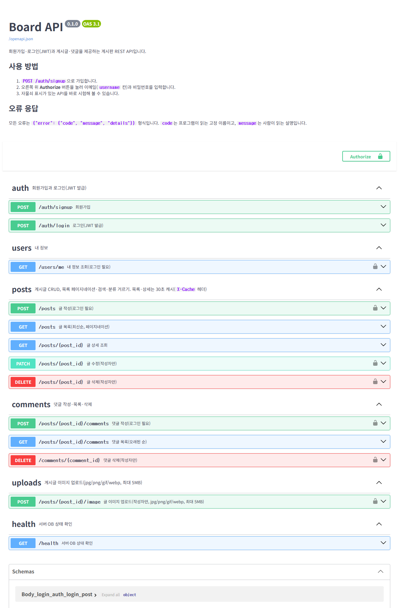
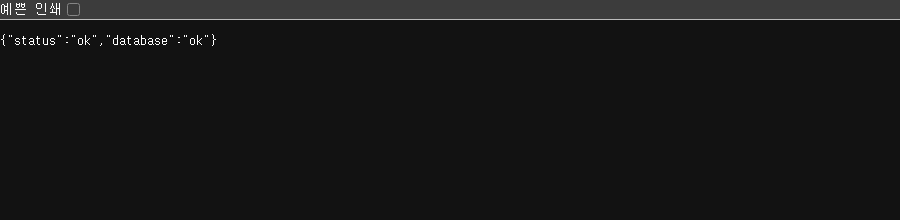
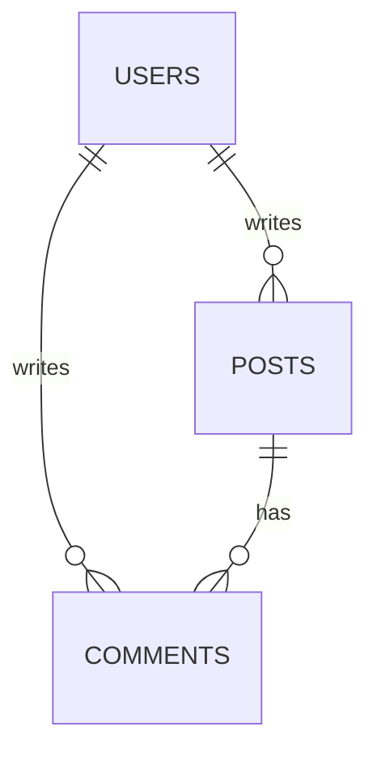
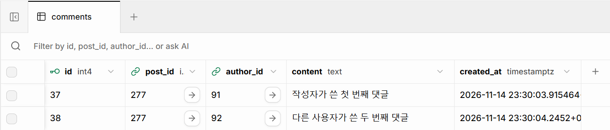

# Board API (board-be)

회원가입·로그인(JWT)과 게시글·댓글을 제공하는 **RESTful 게시판 백엔드**입니다.
이전에 만든 정적 HTML 공지사항(board) 화면을, 회원·권한·DB를 갖춘 API 서버로 다시 만들었습니다. [본인 말로 한두 문장 고쳐 쓰기]

## 배포 정보

| 구분 | 주소 |
|---|---|
| 대문(소개 화면) | http://13.125.86.166 |
| **Swagger UI (API 문서·시험)** | http://13.125.86.166/docs |
| ReDoc (읽기용 문서) | http://13.125.86.166/redoc |
| 상태 확인 | http://13.125.86.166/health |
| GitHub | https://github.com/eeseuju/KANT-FastAPI-assignment |

> AWS EC2(Ubuntu 24.04, t3.micro, 서울 리전)에 배포했고, 고정 IP(탄력적 IP)를 연결했습니다. 도메인이 없어 **HTTP**로 접속합니다.





### 채점용 시연 순서 (Swagger에서 3~4분)

1. `POST /auth/signup`으로 가입 (예: 이메일 `a@example.com`, 닉네임 `alice`, 비밀번호 8자 이상)
2. 오른쪽 위 **Authorize** → 이메일(`username` 칸)과 비밀번호 입력 (자물쇠가 잠긴 모양으로 바뀜)
3. `POST /posts`로 글 작성 → `GET /posts`로 목록(최신순, 페이지네이션) 확인 → `GET /posts?q=검색어`로 검색
4. 다른 계정으로 가입·Authorize 후 **그 글을 `PATCH`/`DELETE` → `403`**(작성자만 가능)
5. `POST /posts/{post_id}/comments`로 댓글 작성 → 글을 삭제하면 **댓글도 함께 삭제**(CASCADE)
6. `POST /posts/{post_id}/image`로 이미지 업로드(가짜 이미지는 `415`)

## 주요 기능

- 회원가입·로그인, **JWT 액세스 토큰(30분 만료)**, 비밀번호 **bcrypt 해싱**
- 게시글 작성·조회·수정·삭제, 목록 **페이지네이션·분류 거르기·검색**
- **작성자만** 수정·삭제할 수 있는 권한 검증(다른 사람은 `403`)
- 댓글 작성·목록·삭제, 글을 지우면 댓글도 함께 삭제(CASCADE)
- 글 이미지 업로드(jpg/png/gif/webp, 최대 5MB, **파일 내용으로 종류 검사**)
- 모든 오류를 하나의 JSON 형식으로 통일, Pydantic 입력 검증
- 요청 번호 로깅, CORS 허용 목록, 글 조회 캐시(TTL 30초), DB까지 확인하는 헬스체크
- 대문(`/`)에 소개 화면(서버·DB 상태를 실시간으로 표시)과 문서 바로가기
- OpenAPI(Swagger) 문서, **pytest 79개**

## 기술 스택

Python 3.13 · FastAPI · Pydantic v2 · SQLAlchemy 2.x · Alembic · PostgreSQL(Supabase) · PyJWT · bcrypt · uv · pytest · AWS EC2(Ubuntu) · nginx · systemd

## API 목록

| 메서드 | 경로 | 인증 | 설명 |
|---|---|---|---|
| POST | `/auth/signup` | - | 회원가입 (201, 중복 409) |
| POST | `/auth/login` | - | 로그인, JWT 발급 (폼: `username`=이메일, `password`) |
| GET | `/users/me` | 필요 | 내 정보 |
| POST | `/posts` | 필요 | 글 작성 (201) |
| GET | `/posts` | - | 목록 (`page`, `size`(최대 50), `category`, `q`) |
| GET | `/posts/{post_id}` | - | 상세 |
| PATCH | `/posts/{post_id}` | 작성자 | 일부 수정 |
| DELETE | `/posts/{post_id}` | 작성자 | 삭제 (204) |
| POST | `/posts/{post_id}/comments` | 필요 | 댓글 작성 (201) |
| GET | `/posts/{post_id}/comments` | - | 댓글 목록(오래된 순) |
| DELETE | `/comments/{comment_id}` | 댓글 작성자 | 댓글 삭제 (204) |
| POST | `/posts/{post_id}/image` | 작성자 | 이미지 업로드 |
| GET | `/health` | - | 서버·DB 상태 (DB 장애 시 503) |

게시글 분류는 `공지`, `이벤트`, `업데이트`, `상점`, `보안`, `캐시`, `패치`, `제재`, `점검` 중 하나입니다(이전 board 화면의 분류를 그대로 사용).

## 인증·권한

1. `POST /auth/signup`으로 가입 → `POST /auth/login`으로 토큰 발급
2. 요청 헤더에 `Authorization: Bearer <토큰>` (Swagger에서는 **Authorize** 버튼)
3. 토큰 없음·만료·위조는 `401`, 로그인했지만 작성자가 아니면 `403`
4. 로그인 실패 메시지는 "이메일이 없음"과 "비밀번호 틀림"을 구분하지 않습니다(가입 여부 노출 방지).

## 오류 응답 형식

모든 오류는 같은 모양입니다. `code`는 프로그램용 고정 이름, `message`는 사람용 설명입니다.

```json
{ "error": { "code": "POST_NOT_FOUND", "message": "게시글을 찾을 수 없습니다.", "details": null } }
```

입력 오류(422)는 `details`에 항목별 설명이 들어가며, **사용자가 입력한 값(비밀번호 등)은 응답에 되돌려 주지 않습니다.** 서버 내부 오류(500)는 원인을 서버 로그에만 남기고 응답에는 일반 문구만 보냅니다.

## DB 설계



| 테이블 | 주요 컬럼 |
|---|---|
| `users` | id, email(UNIQUE), username(UNIQUE), hashed_password, created_at |
| `posts` | id, author_id(FK), category, title, content, image_path, created_at, updated_at |
| `comments` | id, post_id(FK, CASCADE), author_id(FK), content, created_at |

- 자주 조회하는 컬럼(`posts.created_at`, `author_id`, `category`, `comments.post_id`)에 인덱스
- 목록·댓글 조회는 `joinedload`로 작성자를 JOIN 한 번에 가져와 **N+1 쿼리 방지**
- 글을 지우면 댓글이 DB에서 함께 지워집니다(`ondelete='CASCADE'`). 자동 테스트(`test_deleting_a_post_removes_its_comments`)가 이를 확인합니다.

**실제 배포 서버에서 확인한 화면** (Supabase Table Editor의 `comments` 테이블). 글 id 277에 댓글 2개를 달고, 그 글을 `DELETE`했습니다.




## 프로젝트 구조

```text
app/
├── main.py            # 앱 생성, 라우터·미들웨어·예외 핸들러 등록, Swagger 설명
├── deps.py            # 로그인한 사용자 찾기(get_current_user)
├── core/              # 설정, 보안(해싱·JWT), 오류 형식, 미들웨어, 캐시, 업로드 저장
├── db/                # 엔진·세션, Base
├── models/            # SQLAlchemy 모델(users, posts, comments)
├── schemas/           # Pydantic 스키마(요청·응답 검증)
└── routers/           # home(대문), auth, users, posts, comments, uploads, health
alembic/               # DB 마이그레이션
tests/                 # pytest 79개
deploy/                # EC2 배포 설정(systemd, nginx, 갱신 스크립트)
```

## 로컬 실행

```powershell
uv sync
copy .env.example .env      # .env를 열어 값을 채운다
uv run alembic upgrade head
uv run uvicorn app.main:app --reload
```

그다음 http://127.0.0.1:8000/docs 를 엽니다.

### 환경변수

| 이름 | 필수 | 설명 |
|---|---|---|
| `DATABASE_URL` | 필수 | PostgreSQL 주소(`postgresql+psycopg://...`) |
| `JWT_SECRET_KEY` | 필수 | JWT 서명 비밀 키(`secrets.token_hex(32)`로 생성) |
| `CORS_ORIGINS` | 선택 | 허용할 출처, 쉼표로 구분(기본: 로컬 개발 주소) |
| `CACHE_TTL_SECONDS` | 선택 | 글 조회 캐시 수명 초(기본 30, 0이면 끔) |

`.env`에는 비밀 값이 들어가므로 GitHub에 올리지 않습니다(`.gitignore`). 키 이름만 담은 `.env.example`을 올렸습니다.

## 테스트

```powershell
uv run pytest -q
```

79개 테스트가 인증·글·댓글·업로드·오류 형식·운영 기능·**API 문서 점검**을 확인합니다. 테스트는 **메모리 SQLite**를 쓰므로 실제 DB를 건드리지 않습니다.

## 배포 (AWS EC2)

Ubuntu 24.04 · t3.micro · `systemd`(uvicorn 1개 프로세스) · `nginx`(80번 → 8000번 프록시, 업로드 6MB 허용). 설정 파일은 [`deploy/`](deploy/)에 있습니다.
코드를 고친 뒤에는 서버에서 `bash deploy/update.sh`로 반영합니다.

## 설계 결정과 배운 점

- **Alembic**: 처음 써 보는 도구였지만 **새로 배워 보고 싶어서** `create_all` 대신 선택했습니다. 테이블 구조가 바뀌어도 데이터를 지우지 않고 변경 이력을 남길 수 있고, EC2에서도 `alembic upgrade head` 한 줄로 같은 구조로 맞출 수 있다는 점도 배웠습니다. [배우면서 막혔던 점이나 느낀 점을 한 줄 추가]
- **`def`와 `async def`**: DB(동기 SQLAlchemy)를 쓰는 API는 `def`로 두고(별도 스레드에서 실행), 파일 업로드만 `async def` + `run_in_threadpool`로 구현했습니다. `async def` 안에서 동기 DB 호출을 하면 서버가 다른 요청을 못 받기 때문입니다.
- **업로드 안전장치**: 사용자가 보낸 파일 이름은 쓰지 않고(무작위 이름), 확장자·Content-Type이 아니라 **파일 내용(매직 넘버)**으로 종류를 확인합니다.
- **캐시 무효화**: 글이 바뀌면(작성·수정·삭제·이미지) 캐시를 비웁니다. 오류 응답은 캐시하지 않습니다.
- **API 문서도 테스트**: 모든 API에 한글 요약·설명·태그와 오류 응답이 문서화되어 있는지 테스트가 검사합니다. (FastAPI는 요약을 안 쓰면 함수 이름으로 영어 요약을 자동으로 만들어서, "한글 요약인지"를 검사하도록 했습니다.)
- [그 밖에 이번 과제에서 가장 크게 배운 점을 본인 말로 한두 줄 추가]

## 한계와 개선 방향

- **HTTPS 미적용**(도메인이 없어 HTTP): 토큰·비밀번호가 암호화되지 않은 채 오갑니다. 도메인과 인증서를 붙이는 것이 첫 개선점입니다.
- 캐시는 서버 프로세스 메모리라 프로세스를 여러 개 띄우면 최대 30초 불일치가 생깁니다(Redis 등으로 개선 가능).
- 업로드 파일은 서버 디스크에 저장됩니다. 서버를 새로 만들면 사라지므로 S3 같은 별도 저장소가 필요합니다.
- Access token만 사용합니다(refresh token 없음).
- 로그인 시 없는 이메일은 해시 비교를 건너뛰어 응답 시간 차이로 가입 여부를 추측할 수 있습니다.
