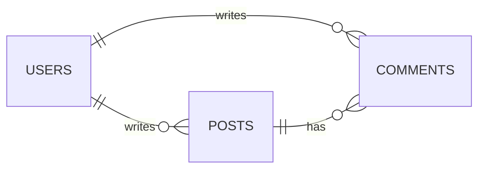
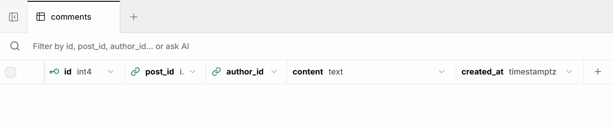
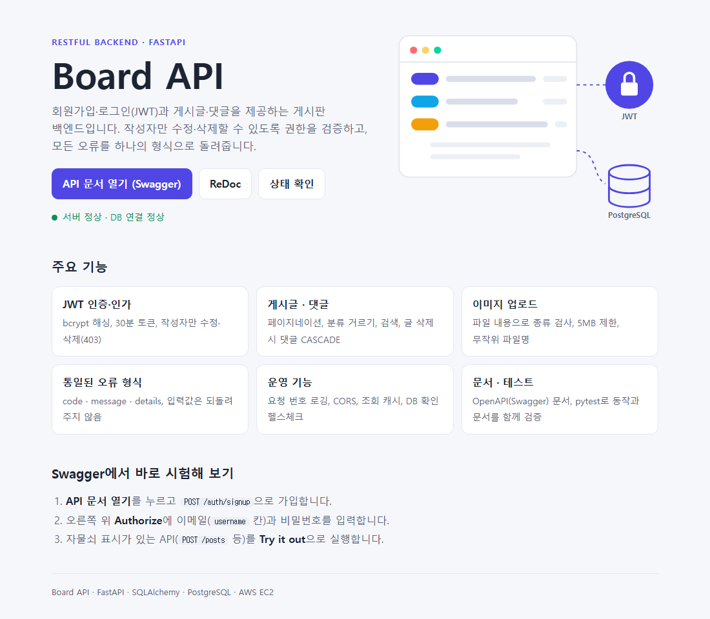
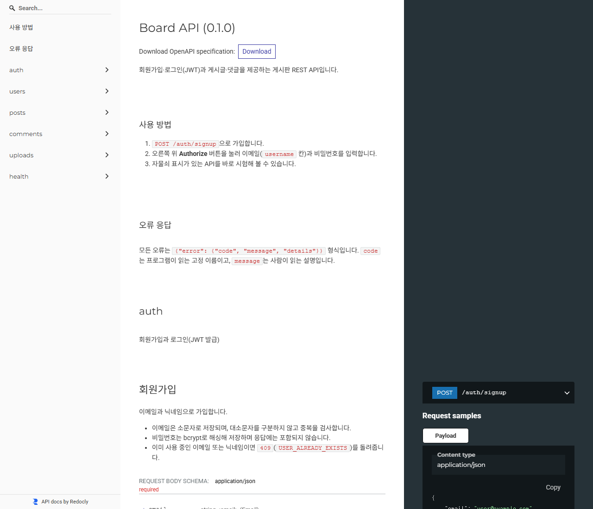

# Board API (board-be)

회원가입·로그인(JWT)과 게시글·댓글을 제공하는 RESTful 게시판 백엔드입니다.  
이전에 참여한 프론트엔드 팀 프로젝트에서 담당했던 [정적 게시판](https://github.com/mjlee0914/FE-project-teamD/tree/main/domains/boards) 영역을 회원·권한·DB를 갖춘 API 서버로 재구성했습니다.

- 기술 스택 : Python 3.13 · FastAPI · Pydantic v2 · SQLAlchemy 2.x · Alembic · PostgreSQL(Supabase) · PyJWT · bcrypt · uv · pytest · AWS EC2(Ubuntu) · nginx · systemd

> **목차**
> - [1. 주요 기능](#1-주요-기능)
> - [2. DB 설계](#2-db-설계)
> - [3. API 목록](#3-api-목록)
> - [4. 오류 응답 형식](#4-오류-응답-형식)
> - [5. 프로젝트 구조](#5-프로젝트-구조)
> - [6. 실행 방법](#6-실행-방법)
> - [7. 설계 결정과 배운점](#7-설계-결정과-배운점)
> - [8. 개선 사항과 한계점](#8-개선-사항과-한계점)

<br>

## 1. 주요 기능

- 회원가입·로그인, JWT 액세스 토큰 (30분 만료), 비밀번호 bcrypt 해싱
- 게시글 작성·조회·수정·삭제, 목록 페이지네이션·분류 거르기·검색
- 작성자만 수정·삭제할 수 있는 권한 검증 (다른 사람은 `403`)
- 댓글 작성·목록·삭제, 글을 지우면 댓글도 함께 삭제 (CASCADE)
- 글 이미지 업로드 (jpg/png/gif/webp, 최대 5MB, 파일 내용으로 종류 검사)
- 모든 오류를 하나의 JSON 형식으로 통일, Pydantic 입력 검증
- 요청 번호 로깅, CORS 허용 목록, 글 조회 캐시(TTL 30초), DB 포함 헬스체크
- 대문(`/`) 소개 화면(서버·DB 상태 표시)과 문서 바로가기 화면 구성 등

<br>

## 2. DB 설계



| 테이블 | 주요 컬럼 |
|---|---|
| `users` | id, email(UNIQUE), username(UNIQUE), hashed_password, created_at |
| `posts` | id, author_id(FK), category, title, content, image_path, created_at, updated_at |
| `comments` | id, post_id(FK, CASCADE), author_id(FK), content, created_at |

- 자주 조회하는 컬럼(`posts.created_at`, `author_id`, `category`, `comments.post_id`)을 인덱스로 구성
- 목록·댓글 조회는 `joinedload`로 작성자를 JOIN 한 번에 가져와 N+1 쿼리 방지
- 글을 지우면 댓글이 DB에서 함께 삭제 (`ondelete='CASCADE'`)

### CASCADE 사례
글 id 277에 댓글 2개를 달고, 그 글을 `DELETE` 할 경우의 DB 변화 입니다.

- **글 삭제 전** : post_id 277과 댓글 2개  

  

- **글 삭제 후** : 댓글도 함께 사라져 테이블이 비어 있음  

  

## 3. API 목록

| 메서드 | 경로 | 인증 | 설명 |
|---|---|---|---|
| POST | `/auth/signup` | - | 회원가입 (201, 중복 409) |
| POST | `/auth/login` | - | 로그인, JWT 발급 (폼: `username`=이메일, `password`) |
| GET | `/users/me` | 필요 | 내 정보 |
| POST | `/posts` | 필요 | 글 작성 (201) |
| GET | `/posts` | - | 목록 (`page`, `size`(최대 50), `category`, `q`) |
| GET | `/posts/{post_id}` | - | 상세 |
| PATCH | `/posts/{post_id}` | 작성자 | 일부 수정 |
| DELETE | `/posts/{post_id}` | 작성자 | 삭제 (204) |
| POST | `/posts/{post_id}/comments` | 필요 | 댓글 작성 (201) |
| GET | `/posts/{post_id}/comments` | - | 댓글 목록(오래된 순) |
| DELETE | `/comments/{comment_id}` | 댓글 작성자 | 댓글 삭제 (204) |
| POST | `/posts/{post_id}/image` | 작성자 | 이미지 업로드 |
| GET | `/health` | - | 서버·DB 상태 (DB 장애 시 503) |

*※ 게시글 분류는 `공지`, `이벤트`, `고객문의`, `커뮤니티` 4가지 중 하나입니다. 그 밖의 값은 `422`로 거절합니다.*

<br>

## 4. 오류 응답 형식

모든 오류는 같은 모양입니다. `code`는 프로그램 코드, `message`는 사용자 설명입니다.  
서버 내부 오류(500)는 원인을 서버 로그에만 남기고 응답에는 일반 문구만 보냅니다.

```json
{ "error": { "code": "POST_NOT_FOUND", "message": "게시글을 찾을 수 없습니다.", "details": null } }
```

<br>

## 5. 프로젝트 구조

```text
app/
├── main.py            # 앱 생성, 라우터·미들웨어·예외 핸들러 등록, Swagger 설명
├── deps.py            # 로그인한 사용자 찾기(get_current_user)
├── core/              # 설정, 보안(해싱·JWT), 오류 형식, 미들웨어, 캐시, 업로드 저장
├── db/                # 엔진·세션, Base
├── models/            # SQLAlchemy 모델(users, posts, comments)
├── schemas/           # Pydantic 스키마(요청·응답 검증)
└── routers/           # home(대문), auth, users, posts, comments, uploads, health
alembic/               # DB 마이그레이션
tests/                 # pytest 81개
deploy/                # EC2 배포 설정(systemd, nginx, 갱신 스크립트)
```

<br>

## 6. 실행 방법

### 6-1. 로컬 실행

```powershell
uv sync
copy .env.example .env      # .env를 열어 값을 채웁니다.
uv run alembic upgrade head
uv run uvicorn app.main:app --reload # 그 다음 http://127.0.0.1:8000/docs 를 엽니다.
```
이 프로젝트에서 사용하는 환경변수는 아래와 같습니다.

| 이름 | 필수 | 설명 |
|---|---|---|
| `DATABASE_URL` | 필수 | PostgreSQL 주소(`postgresql+psycopg://...`) |
| `JWT_SECRET_KEY` | 필수 | JWT 서명 비밀 키(`secrets.token_hex(32)`로 생성) |
| `CORS_ORIGINS` | 선택 | 허용할 출처, 쉼표로 구분(기본: 로컬 개발 주소) |
| `CACHE_TTL_SECONDS` | 선택 | 글 조회 캐시 수명 초(기본 30, 0이면 끔) |

### 6-2. 배포 정보

| 구분 | 주소 |
|---|---|
| 소개 화면 | http://13.125.86.166 |
| Swagger UI (API 문서 및 테스트 환경) | http://13.125.86.166/docs |
| ReDoc (읽기용 문서) | http://13.125.86.166/redoc |
| 상태 확인 | http://13.125.86.166/health |

### 6-3. 배포 화면

<table>
  <tr>
    <th width="46%"><a href="http://13.125.86.166">소개 화면</a></th>
    <th width="54%"><a href="http://13.125.86.166/docs">Swagger UI</a></th>
  </tr>
  <tr>
    <td align="center" valign="top"></td>
    <td align="center" valign="top" rowspan="3"></td>
  </tr>
  <tr>
    <th><a href="http://13.125.86.166/redoc">ReDoc</a></th>
  </tr>
  <tr>
    <td align="center" valign="top"></td>
  </tr>
</table>

### 6-4. 시연 시나리오

```text
1. `POST /auth/signup`으로 가입 (예: 이메일 `a@example.com`, 닉네임 `alice`, 비밀번호 8자 이상)
2. 오른쪽 위 Authorize → 이메일(`username` 칸)과 비밀번호 입력 (자물쇠가 잠긴 모양으로 바뀜)
3. `POST /posts`로 글 작성 → `GET /posts`로 목록(최신순, 페이지네이션) 확인 → `GET /posts?q=검색어`로 검색
4. 다른 계정으로 가입·Authorize 후 그 글을 `PATCH`/`DELETE` → `403`(작성자만 가능)
5. `POST /posts/{post_id}/comments`로 댓글 작성 → 글을 삭제하면 댓글도 함께 삭제(CASCADE)
6. `POST /posts/{post_id}/image`로 이미지 업로드(가짜 이미지는 `415`)
```

<br>

## 7. 설계 결정과 배운점

- Alembic : 처음 써 보는 도구였지만 새로 배워 보고 싶어서 `create_all` 대신 선택했습니다. 테이블 구조가 바뀌어도 데이터를 지우지 않고 변경 이력을 남길 수 있고, EC2에서도 `alembic upgrade head` 한 줄로 같은 구조로 맞출 수 있다는 점도 배웠습니다.
- `def`와 `async def` : DB(동기 SQLAlchemy)를 쓰는 API는 `def`로 두고(별도 스레드에서 실행), 파일 업로드만 `async def` + `run_in_threadpool`로 구현했습니다. `async def` 안에서 동기 DB 호출을 하면 서버가 다른 요청을 못 받기 때문입니다.
- 파일 업로드 안전장치 : 사용자가 보낸 파일 이름은 쓰지 않고(무작위 이름), 확장자·Content-Type이 아니라 파일 내용(매직 넘버)으로 종류를 확인합니다.
- 캐시 무효화 : 글이 바뀌면(작성·수정·삭제·이미지) 캐시를 비웁니다. 오류 응답은 캐시하지 않습니다.

<br>

## 8. 개선 사항과 한계점

- HTTP이므로 토큰·비밀번호가 암호화되지 않은 채 오갑니다. 도메인과 인증서를 붙이는 작업이 필요합니다.
- 캐시는 서버 프로세스 메모리라 프로세스를 여러 개 띄우면 최대 30초 불일치가 생깁니다. (Redis 등으로 개선 가능)
- 업로드 파일은 서버 디스크에 저장됩니다. 서버를 새로 만들면 사라지므로 S3 같은 별도 저장소가 필요합니다.
- Access token만 사용합니다. (refresh token 없음)
- 로그인 시 없는 이메일은 해시 비교를 건너뛰어 응답 시간 차이로 가입 여부를 추측할 수 있습니다.
